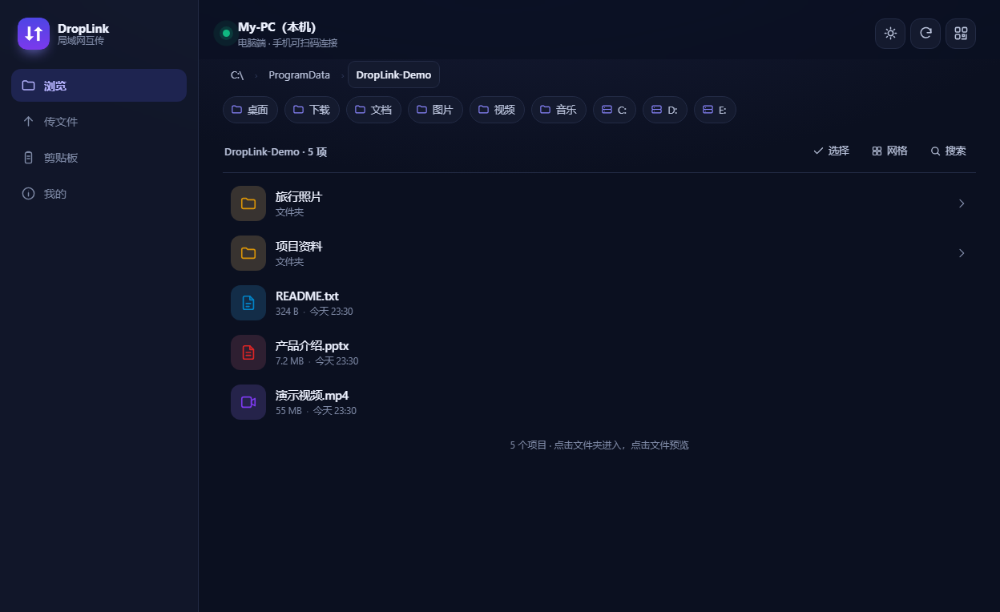
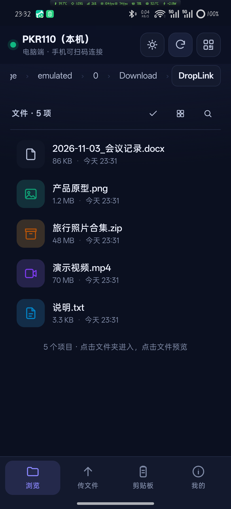

<div align="center">

# DropLink

**Move files between your PC and your phone over the same Wi-Fi. No cloud, no account, no upload quota.**

[**⬇ Download for Windows**](https://github.com/HU4222/droplink/releases/latest/download/DropLink.exe) ·
[**⬇ Download for Android**](https://github.com/HU4222/droplink/releases/latest/download/DropLink-Android.apk) ·
[**All releases**](https://github.com/HU4222/droplink/releases/latest)

</div>

> **中文**：DropLink 让电脑和手机在**同一个 Wi-Fi** 下直接互传文件。不走互联网、不上传云端、不需要注册账号，也不消耗手机流量。上面两个按钮直接下载电脑版和安卓版成品。

---

## ⬇ Download

| Platform | File | Size | Notes |
|---|---|---|---|
| **Windows 10 / 11** | [`DropLink.exe`](https://github.com/HU4222/droplink/releases/latest/download/DropLink.exe) | ~15 MB | **Personal edition** — portable, no install, no Python needed |
| **Windows 10 / 11** | [`DropLink-Secure.exe`](https://github.com/HU4222/droplink/releases/latest/download/DropLink-Secure.exe) | ~25 MB | **Secure edition** — TLS, device approval, confirm-before-receive |
| **Android 8.0+** | [`DropLink-Android.apk`](https://github.com/HU4222/droplink/releases/latest/download/DropLink-Android.apk) | ~1.2 MB | Sideload; "Install unknown apps" must be allowed |
| **iPhone / iPad / HarmonyOS** | — no install — | — | Open the address shown on the desktop in any browser; everything except background resume and notification actions works the same |
| Checksums | [`SHA256SUMS.txt`](https://github.com/HU4222/droplink/releases/latest/download/SHA256SUMS.txt) | 1 KB | Verify your download |

Full changelog: [`CHANGELOG.md`](CHANGELOG.md) · All builds: [Releases](https://github.com/HU4222/droplink/releases)

> **中文**：电脑版是**单文件绿色版**，双击即用，不需要装 Python；安卓版是原生 App，需要允许「安装未知来源应用」；iPhone / iPad / 鸿蒙 **不用安装**，浏览器打开电脑端显示的地址即可。传输走局域网直连，不经过任何中转服务器。下载后可以用 SHA256SUMS.txt 核对文件完整性，历史版本都在 Releases 页面。

---

## What is DropLink?

DropLink turns your PC into a small local file server and gives your phone a native app (or just a browser tab) to browse, preview, upload and download files from it. Everything happens on your own LAN — the two devices talk directly to each other.

Typical uses: moving photos off your phone without a cable, grabbing a document from your PC while lying on the sofa, sending a file to a colleague on the same office Wi-Fi.

### Key facts

- **No relay server.** Files never touch the internet; the phone talks straight to the PC's IP address.
- **No account, no telemetry.** There is nothing to sign in to and nothing is collected.
- **Works offline.** As long as both devices are on the same router (or the phone connects to the PC's hotspot), it works with the internet unplugged.
- **Zero third-party dependencies on the desktop side** — pure Python standard library, no pip install.

> **中文**：DropLink 把电脑变成一个小型局域网文件服务，手机端用原生 App（也可以用浏览器）浏览、预览、上传、下载电脑上的文件，全程只在你自己的局域网里跑，不经过任何中转服务器。不需要账号，不采集数据，断网也能用；电脑端只用 Python 标准库，不装任何第三方包。

---

## Features

| Area | What you get |
|---|---|
| **Browse** | Walk every drive on the PC, breadcrumb navigation, sort by folder/name, search, "quick roots" for Desktop / Downloads / Documents / Pictures / Videos |
| **Preview** | Images, video, audio, PDF, and text/code inline — no download needed |
| **Transfer** | Multi-file upload, whole-folder upload (keeps the directory tree), download, batch ZIP, drag-and-drop from the browser |
| **Big files** | Streaming I/O, HTTP Range (resume), verified 10 GB transfers at ~200 MB/s on gigabit Wi-Fi |
| **Extras** | Clipboard sync between devices, PC→phone push, QR code to connect, dark/light theme, PWA "add to home screen" |
| **Phone app** | Native Android toolbar + WebView UI, camera QR scanner, hotspot shortcut, foreground service so transfers survive screen-off, download to any folder via SAF |

> **中文**：功能包括——浏览整台电脑的磁盘（面包屑、搜索、常用目录快捷入口）；图片/视频/音频/PDF/文本在线预览；多文件与整文件夹上传（保留目录结构）、批量打包下载；10 GB 大文件流式传输与断点续传；剪贴板互发、电脑推送文件到手机、扫码连接、深浅主题、PWA 添加到主屏幕。安卓端有相机扫码、热点快捷开关、前台服务保活，以及通过系统文件选择器保存到任意目录。

---

## Screenshots

| Desktop (browser or built-in window) | Android app |
|---|---|
|  |  |

> **中文**：左图是电脑端界面（内置窗口或任意浏览器打开都可以），右图是安卓 App。两端看到的是同一套界面，只是手机端做了移动端布局。

---

## Quick start

1. **Run `DropLink.exe` on the PC.** A window opens showing a QR code, your LAN address (e.g. `http://192.168.1.7:8848`) and a 6-digit pairing code.
2. **Connect the phone** — either scan the QR code with the Android app, or type the address into any browser on the same Wi-Fi.
3. **Pair once.** Enter the pairing code — 6 digits on the personal edition, **8 digits on the secure edition** (which also asks you to approve the device on the PC).

Files you send from the phone land in `Desktop\DropLink 接收` by default; you can change the receive folder from the PC window.

> **中文**：三步——① 电脑双击 `DropLink.exe`，窗口会显示二维码、局域网地址和 6 位配对码；② 手机用 App 扫码，或在浏览器里输入这个地址（必须连同一个 Wi-Fi）；③ 输入一次配对码即可，之后自动记住。手机传过来的文件默认落在桌面上的「DropLink 接收」文件夹，可以在电脑窗口里改。

---

## Repository layout

```
.
├── desktop/                 Windows / Python side
│   ├── server.py            HTTP server entry point
│   ├── dlcore/              config / state / fsutil / api / httpd …
│   ├── dlcore/sec/          secure edition only: TLS, trust, approval, pathguard, ratelimit
│   ├── app_main.py          EXE entry point (start server, tray, open UI)
│   ├── gui.py               Native window + tray icon (ctypes → Win32)
│   ├── qrmini.py            Dependency-free QR code and icon renderer
│   ├── web/                 Web UI (plain HTML/CSS/JS, no build step)
│   ├── build/               Packaging, launchers and self-test suites
│   └── *.bat                One-click helpers (firewall rule, extras)
├── android/                 Android app (Kotlin, minSdk 26, AGP 8.5)
│   └── app/src/main/
│       ├── java/…/          HttpServer, WebView host, QR scanner, hotspot
│       ├── assets/www/      The same web UI, bundled for offline use
│       └── res/             Launcher icons, themes
├── docs/                    Architecture, API reference, build guide, FAQ
└── tools/                   Icon generator shared by both platforms
```

> **中文**：仓库分三块——`desktop/` 是电脑端（Python 服务 + 原生窗口 + 网页界面 + 打包与自检脚本），`android/` 是安卓端（Kotlin，内嵌同一套网页界面，离线可用），`docs/` 是架构、接口、构建和排错文档，`tools/` 是两端共用的图标生成脚本。

---

## Security & privacy

DropLink is designed for **trusted home / office networks**. That is a deliberate trade-off, and you should know exactly what it means:

- The default ("personal") mode trusts requests coming from the machine itself, so the PC UI opens without a password. A 6-digit pairing code gates every other device.
- Traffic is plain HTTP on the LAN. On a network you do not control (café Wi-Fi, hotel), someone who can sniff traffic could read it. Use your phone's hotspot instead.
- **Since 1.5.0 there are two builds from the same codebase.** `DropLink.exe` (personal) keeps the plain-HTTP, no-approval behaviour described above. `DropLink-Secure.exe` is the hardened profile, always on: TLS with a self-signed certificate, device approval, confirm-before-receive, per-file one-time upload tokens, path hardening (UNC / ADS / reparse points / reserved names), per-endpoint rate limiting, log redaction and quota. The two builds do not interoperate.
- The phone app can write only into its receive folder when driven from the PC; the phone's own UI keeps full access.

See [`SECURITY.md`](SECURITY.md) for the full threat model, including what DropLink explicitly does **not** protect against.

> **中文**：DropLink 面向**可信的家庭/办公局域网**，这是有意的取舍：默认「个人模式」信任本机请求，所以电脑界面不需要密码，其它设备凭 6 位配对码接入；局域网内是明文 HTTP，在不可控的网络（咖啡厅、酒店）请改用手机热点。启动时加 `--secure` 可开启加固模式：Host/Origin 校验、本机一次性令牌、敏感目录屏蔽、拒绝 UNC/ADS 路径、8 位配对码、会话 30 天过期。完整威胁模型见 `docs/SECURITY.md`。

---

## Build from source

**Desktop** needs Python 3.9+; nothing to install.

```bash
cd desktop
python server.py            # runs from source, opens the UI
python build/build_exe.py   # rebuilds the single-file DropLink.exe
```

**Android** needs JDK 17 and the Android SDK (compileSdk 34).

```bash
cd android
./gradlew assembleDebug     # app/build/outputs/apk/debug/app-debug.apk
```

Release signing is read from `DROPLINK_KEYSTORE`, `DROPLINK_STORE_PASSWORD`, `DROPLINK_KEY_ALIAS`, `DROPLINK_KEY_PASSWORD`. Without them the release build falls back to the debug key so the project still compiles for a fresh clone.

Details and troubleshooting: [`docs/BUILD.md`](docs/BUILD.md).

> **中文**：电脑端只要 Python 3.9+，`python server.py` 直接跑源码，`python build/build_exe.py` 重新打包单文件 EXE。安卓端需要 JDK 17 和 Android SDK（compileSdk 34），`./gradlew assembleDebug` 即可；发布签名通过四个环境变量注入，没配置时自动退回 debug 签名，保证 clone 下来就能编译。

---

## Documentation

| Document | What's inside |
|---|---|
| [`docs/ARCHITECTURE.md`](docs/ARCHITECTURE.md) | How the pieces fit: HTTP server, WebView host, threading model, data flow |
| [`docs/API.md`](docs/API.md) | Every HTTP endpoint with parameters and responses |
| [`docs/BUILD.md`](docs/BUILD.md) | Full build instructions for both platforms, signing, packaging |
| [`SECURITY.md`](SECURITY.md) | Threat model, personal vs secure edition, what is explicitly out of scope |
| [`docs/EDITIONS.md`](docs/EDITIONS.md) | Personal vs secure: defaults, error codes, rate limits, quota |
| [`docs/TROUBLESHOOTING.md`](docs/TROUBLESHOOTING.md) | "Phone can't connect", firewall, AP isolation, VPN, port conflicts |
| [`CHANGELOG.md`](CHANGELOG.md) | Version history |

> **中文**：`docs/` 下有四份文档——架构说明（服务端/WebView/线程模型/数据流）、完整 HTTP 接口表、两端构建与签名打包、威胁模型与个人模式/加固模式对照；另有排错手册覆盖「手机连不上」、防火墙、AP 隔离、VPN、端口占用等常见问题。

---

## FAQ

**Does it work without internet?** Yes. Both devices only need to reach each other on the LAN.

**Do I need to install Python on the PC?** No — the released EXE embeds the interpreter.

**Why does Windows Defender / SmartScreen warn me?** The EXE is not code-signed (a certificate costs money), so SmartScreen shows "unknown publisher". You can verify the SHA-256 against `SHA256SUMS.txt`, or build it yourself from this repository.

**Can I use it over the internet?** No, by design. Use a VPN if you really need remote access; DropLink has no NAT traversal and no relay.

**How many devices at once?** Several phones can connect to one PC; each pairs once.

> **中文**：常见问题——断网可用；电脑不用装 Python（EXE 内嵌运行时）；Windows 提示「未知发布者」是因为 EXE 没有代码签名（证书要花钱），可以用 SHA256SUMS.txt 校验或自己从源码编译；不支持公网直连（设计如此，确实需要就用 VPN）；一台电脑可以同时连多台手机，每台配对一次。

---

## License

MIT — see [`LICENSE`](LICENSE).

> **中文**：MIT 许可证，详见 `LICENSE`。可以自由使用、修改、二次分发，保留版权声明即可。
